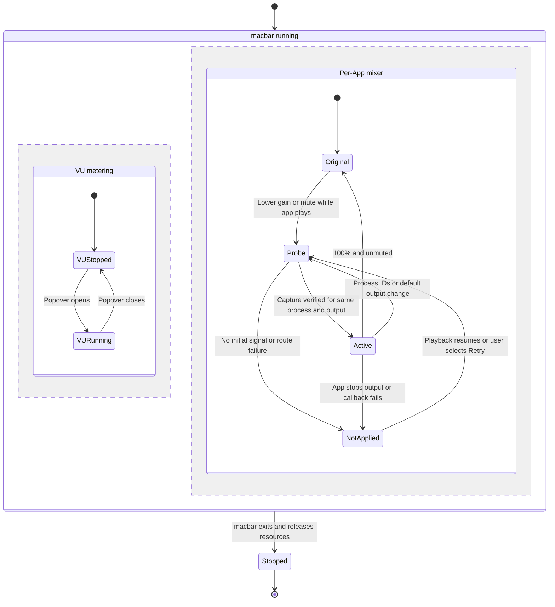

# 架構

macbar 有兩條彼此獨立的音訊路徑：系統音量與 VU 控制，以及逐 App 輸出 mixer。前者改變目前預設裝置的主音量、mute 與量測狀態；後者只處理指定 App 的播放音訊。Popover 關閉會停止 VU meter，但不會停止逐 App mixer。

## 程式模組

| 檔案 | 職責 |
|---|---|
| `Sources/macbar/main.swift` | 建立 `NSApplication`、安裝 `AppDelegate`，使用 accessory activation policy。 |
| `Sources/macbar/AppDelegate.swift` | 建立狀態列與 popover；啟動 `AppAudioController`；開啟 popover 時啟動 VU，關閉時停止 VU；退出時停止兩條量測／路由生命週期。 |
| `Sources/macbar/AudioController.swift` | 控制系統預設輸入、輸出的音量與 mute，監聽裝置切換，保存系統軟體 mute 狀態，管理 VU monitor 的啟停。 |
| `Sources/macbar/PopoverView.swift`、`AppAudioView.swift` | 呈現系統音量列、VU bar 與逐 App 清單、音量、mute、路由狀態及 Retry。 |
| `Sources/macbar/LevelMeter.swift` | 將樣本 RMS 映射為 level，並平滑 attack/release。 |
| `Sources/macbar/MicLevelMonitor.swift` | 透過 `AVAudioEngine` input tap 量測麥克風 level；使用系統麥克風 TCC。 |
| `Sources/macbar/OutputLevelMonitor.swift` | 透過 CoreAudio process tap 與 private aggregate device 量測輸出 VU；只由 popover 的 metering 狀態啟停。 |
| `Sources/macbar/AppAudioController.swift` | 維護逐 App gain、程序分組、route、錯誤與 UI 狀態；監聽程序及預設輸出，並定期檢查 route。 |
| `Sources/macbar/AppAudioDiscovery.swift`、`AppAudioState.swift` | 查詢 CoreAudio process、辨識外層 `.app` 與 parent/helper，排除 macbar，提供分組、gain 狀態、route health 與資源清理堆疊。 |
| `Sources/macbar/AppAudioRoute.swift` | 為一組程序建立 process tap、aggregate device 及 IOProc；驗證輸出拓樸、執行試探 route 與正式 route，並負責清理。 |
| `Sources/AppAudioRT/AppAudioRT.c`、`include/AppAudioRT.h` | C real-time IOProc 與原子 gain/state。檢查 callback buffer、套用 stereo gain，並將輸出寫入 aggregate 的 physical output。 |
| `Scripts/make-app.sh`、`Scripts/make-dmg.sh` | 組裝 ad-hoc signed app 與版本化 DMG。 |

## 逐 App 音訊資料流

```mermaid
flowchart LR
    HAL[CoreAudio process list and output listeners] --> DISC[AppAudioDiscovery]
    DISC --> GROUP[Group app and helper processes; exclude macbar]
    GROUP --> CTRL[AppAudioController: volatile gain and route state]
    CTRL --> ROUTE[AppAudioRoute]
    ROUTE --> TAP[Private process tap: selected process IDs]
    TAP --> AGG[Private aggregate: current physical output plus stereo tap]
    AGG --> CHECK[Validate stream layout, format, channel map and sample rate]
    CHECK --> DISABLE[Disable physical input streams]
    DISABLE --> IO[AppAudioRT C IOProc]
    IO --> OUT[Validated physical output stream]
    OUT --> DEVICE[Current default output]
```

`AppAudioController` 以 HAL listener 追蹤 process list、預設輸出、程序輸出狀態及輸出裝置格式；即使 listener 安裝失敗，250ms timer 仍持續檢查，並約每秒重新探索程序。相同外層 App 的程序合併為一列，macbar 自身與其 helper 不會被控制。

使用者保持 100% 且未 mute 時，controller 不建立 route，音訊沿原始輸出播放。需要衰減或 mute 時，`AppAudioRoute` 先建立 `muteBehavior = unmuted` 的 probe route，process tap 輸出先以 0 gain 送入 callback；原始音訊仍可播放。Controller 必須觀察到 callback 與非靜音 sample signal，才會停止 probe，並以 `muteBehavior = mutedWhenTapped` 重建正式 route。正式 route 才會抑制原始播放並依指定 gain 重播，避免在權限未確認或 tap 無資料時顯示虛假的成功狀態。

Aggregate 建立後由 C target 重新讀取並驗證 topology。支援單一實體 subdevice、一條 Float32 physical output stream（1–32 聲道）及一個 stereo Float32 tap；輸出與 tap sample rate 必須相同。實體輸入 stream 必須是 aggregate input 的連續 prefix，且會停用並讀回確認；IOProc 只讀附加的 tap buffers，不檢查停用 input prefix 的資料指標或內容。Stereo tap 依 `PreferredChannelsForStereo` 選擇 L/R，沒有該屬性時使用前兩聲道；mono 輸出取 L/R 平均，其餘輸出聲道清零。無法驗證 stream、channel map、buffer layout 或 sample rate 時，route 建立失敗，保留原始播放。

C IOProc 只使用固定大小的拓樸描述與 lock-free atomics 傳遞 gain、enabled、fault 與 callback health，不在 callback 中配置資源或取得鎖。每次 callback 驗證 buffer 數、聲道、frame 數、對齊與 sample 值，再套用 0–1 gain。格式錯誤或非有限 sample 會設 fault、清除輸出，讓 Swift controller 停止 route 並顯示錯誤。

## VU 與 mixer 的生命週期

- `applicationDidFinishLaunching` 立即呼叫 `AppAudioController.start()`。它在 popover 開啟與否都追蹤程序、route 與預設輸出。Popover 關閉時 `AudioController.setMeteringActive(false)` 只停止 mic/output VU monitor，已套用的逐 App route 繼續運作。
- 預設輸出改變、程序退出或同一 App 的 process IDs 改變時，controller 停止舊 route 並重新探索／建立；設定回到 100% 且未 mute 時會移除 route，恢復原始播放。
- 逐 App gain、mute 與錯誤只存在 `AppAudioController` 記憶體，本次執行結束後不保留。系統控制器自己的軟體 mute 狀態另由 `UserDefaults` 保存。
- 退出時 `AppDelegate` 停止 VU 與 app mixer。每取得一項 HAL 資源，`AppAudioCleanup` 就登記其逆向清理，失敗與正常停止都依反向順序釋放 IOProc、aggregate、tap 與 callback context。若 HAL 無法確認 IOProc 與 aggregate 已銷毀，程式保留 callback context，避免 HAL callback 使用已釋放記憶體，並寫入錯誤 log。
- 不支援的 OS、permission、音訊格式或拓樸不會套用靜音 route。UI 顯示未套用的錯誤與 Retry；初次 capture 驗證要求目標 App 正在播放音訊。使用者可先允許系統音訊存取、播放音訊，再按 Retry。

## 已知限制

- VU 的 process tap 需要 macOS 14.4+；macOS 13 與 14.3 的逐 App 控制不支援。這些舊系統版本尚未完成人工實機驗證。
- 逐 App route 只支援一個 physical output stream、一個實體 subdevice、1–32 聲道 Float32 輸出、一個 stereo Float32 tap，且 sample rate 必須一致。其他裝置拓樸會拒絕 route，不代表硬體或驅動必然不相容。
- Boom3D 完整相容性未驗證，也不保證支援。曾觀察到啟用 Boom 時 Firefox 的 process audio 資訊缺失；停用 Boom、改用內建輸出並重新播放後，Firefox 才出現在清單。這些觀察不足以判定原因。
- 系統音訊權限被拒、目標 App 尚未發聲、callback 停滯或 buffer 格式不支援時，不得把 route 視為已套用。看不到有效路由時先確認權限及目標播放，再使用 Retry。
- Probe 驗證後，靜音 sample 可能是目標 App 的正常靜音；health monitor 會以 callback 停滯或 buffer fault 判錯，不會只因沒有新 signal 就推定 TCC 已撤銷。已驗證 route 遇到 TCC 撤銷時的行為仍待人工矩陣確認。
